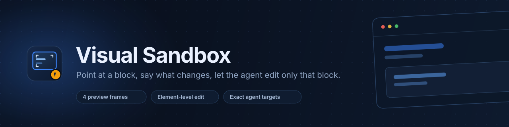

<p align="center">
  <a href="CHANGELOG.md"></a>
  <a href="LICENSE"></a>
  
  
</p>

**Visual Sandbox** puts your UI in the right half of DeepSeek Harness and turns review into
pointing. Hover a block, see its selector, click to pin it, type one line — the agent gets an
exact target instead of a paragraph of description.

It renders workspace HTML in four honest frames, lets you inspect real DOM elements, and
queues every annotation until you send it. The agent then edits **only** the blocks you
touched.

---

## Highlights

| | |
| --- | --- |
| **Four frames** | Responsive (fluid), Mobile `390×844`, Tablet `768×1024`, Desktop `1024×720`. Bezel and window chrome stay crisp while only the app viewport scales. |
| **Edit UI** | Hover outlines with live selector tags, click to pin, popover for the note. `Enter` sends, `Shift+Enter` breaks the line. |
| **Surgical by design** | `[#1 mobile: button.seg]` plus box, computed styles, HTML and text reach the agent with a standing rule: change only these targets. |
| **Auto-detected sources** | The newest workspace `.html`/`.htm` file loads itself; localhost URLs work for dev servers, Expo web, Flutter web, Tauri or Electron renderers. |
| **Open by default** | The panel reveals itself when a Session opens, and a `Preview` toggle in the composer forces it open or closed. |
| **No build step** | Plain ESM loaded by the Harness module loader. Edit a file, refresh the page. |

## Install

**Requires** DeepSeek Harness (desktop app or `dsh web`) with a working profile.
The plugin ships as a bundle package — install it from your clone, not from npm.

```bash
git clone https://github.com/Surenkh/dsh-visual-sandbox.git
```

Then register it in `~/.dsh/profiles/<profile>/package.json`:

```jsonc
{
  "dependencies": {
    "@local/dsh-visual-sandbox": "link:../../path/to/dsh-visual-sandbox"
  },
  "dsh": {
    "profile": {
      "bundles": [
        "@deepseek-ai/dsh-base",
        "@deepseek-ai/dsh-web-app",
        "@local/dsh-visual-sandbox"
      ]
    }
  }
}
```

A git dependency works too, if you would rather not keep a local clone:

```jsonc
"@local/dsh-visual-sandbox": "github:Surenkh/dsh-visual-sandbox"
```

```bash
cd ~/.dsh/profiles/<profile>
pnpm install
```

Restart Harness and **refresh the app page once** so the client half loads. The plugin then
appears as *Visual Sandbox* in the right sidebar's guide.

> **Upgrading:** `git pull`, `pnpm install`, restart, refresh.

## Use it

1. **Load a source.** Type a workspace path such as `index.html`, pick one from the chevron
   list, or paste `http://localhost:3000`. Press Enter.
2. **Pick a frame.** Responsive, Mobile, Tablet or Desktop. Zoom stays at *Fit* until you
   choose another step; fixed frames scale from the top of the studio canvas.
3. **Switch to Edit UI.** Hover a block — it outlines and names its selector. Click it.
4. **Write the note** and press Enter. Repeat for each block that is wrong.
5. **Send All**, add context in the chat, and let the agent make the surgical edit.

The panel can also be opened from the conversation-header sparkle, from the composer's
**Preview** button, or by the agent through `open_visual_sandbox`.

### What an annotation records

| Field | Content |
| --- | --- |
| `id` + note | Stable number and the text you typed |
| `platformMode` + viewport | Which frame it was measured in, e.g. `mobile 390x844` |
| `selector` | Unique CSS path (`#id` when unique, otherwise `tag:nth-of-type` chains) |
| `html` / `text` | Cleanly truncated `outerHTML` and visible text |
| `box` + normalized % | Pixel rectangle plus x/y/width/height inside the app window |
| `styles` | Layout, color, typography, border, flex/grid and shadow values |

Cross-origin URL frames cannot be inspected, so there you drag a rectangle instead — the
same numbered pin and note flow applies.

## Sources

1. **Auto-detected workspace HTML** — scans the workspace (skipping `node_modules`, `.git`,
   `.next`, `.nuxt`, caches), lists newest first, loads the newest when nothing is active.
2. **Local URL** — any `http://`/`https://` preview, including dev servers and native-webview
   targets.

Workspace previews inline local stylesheets, scripts, images, media, fonts and CSS
`url(...)` assets into one self-contained document; CSP and `<base>` tags are stripped.
Module imports that need the original server may still fail — use a live URL for those.

**Expand Narrow Containers** strips hardcoded mobile-demo `max-width` wrappers so a
mobile-first page fills the wider frames. Workspace previews only.

## Agent integration

| Tool | Purpose |
| --- | --- |
| `open_visual_sandbox` | Reveals the workbench, optionally with a `path`, `url` or `platformMode`. |
| `set_sandbox_platform_mode` | Switches the preview frame from the agent. |
| `get_visual_annotations` | Returns the queue as structured targets. |
| `clear_visual_annotations` | Empties the queue after the edit lands. |
| `refresh_visual_sandbox` | Reloads the preview from disk. |

Every Session carries a prompt section with two mandatory preview rules — never draw a fake
bezel, Dynamic Island or status bar in the previewed page, and re-open/refresh the sandbox
automatically when a previewable file changes.

While annotations exist, the section also injects each target as
`### Annotation #N` with its selector, styles and text, plus the surgical-edit rule: modify
only those targets, then call `refresh_visual_sandbox`.

## Architecture

```
client.js ── right sidebar tab ── toolbar · frames · preview iframe · annotation queue
          └─ chat composer ─────── Preview toggle

preview iframe (sandboxed, opaque origin)
   └─ injected inspector  ── postMessage ──▶  panel

index.js ── /api/plugin/visual-sandbox/{state,render,discover}
         ── host tools + per-agent prompt section + workspace inliner
```

| File | Role |
| --- | --- |
| `index.js` | Host half: Session state, the three routes, the five tools, prompt section, HTML inliner, file discovery. |
| `client.js` | Browser half: frames, source bar, studio canvas, inspector bridge, annotation tray, composer toggle, host sync. |
| `cordis.patch.yml` | Registers the plugin under the `dsh-visual-sandbox` bundle id. |
| `locale/{en,zh}.json` | Plugin inventory title and description. |
| `icon.svg` | The mark used by the sidebar guide. |

## Safety and limits

- Workspace previews run in a `sandbox` iframe with an **opaque origin** — no access to
  Harness storage, cookies or the host page. The inspector talks only through `postMessage`.
- Routes are authenticated Host routes on the shared `/api` channel, and workspace roots are
  validated before any file is read.
- Captured selectors, HTML, text and styles reach the agent as **untrusted page data**, never
  as instructions.
- Limits: `4 MB` source · `12 MB` inlined assets · `1 MB` per asset · `300` discovered files
  at depth `8` · `30` annotations · `12 000` characters of prompt data.
- Annotation state is per Session and lives in Host memory for the process lifetime.

## Development

No bundler, no transpiler. Edit `client.js` or `index.js` and reload the Harness page.

```bash
git clone https://github.com/Surenkh/dsh-visual-sandbox.git
# link it into a profile, edit, reload — repeat
```

Ship a change by bumping `version` in `package.json`, adding a `CHANGELOG.md` entry and
tagging the commit.

## License

[MIT](LICENSE) © 2026 Suren Khachatryan
